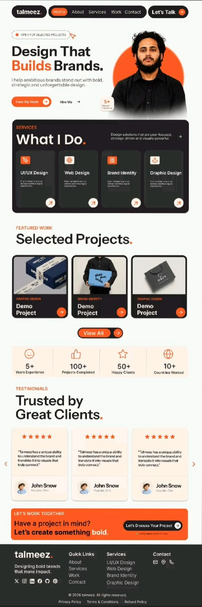

# 🎨 Talmeez — Designer & Brand Strategist Portfolio

<div align="center">



**Design That Builds Brands.**  
*Membantu brand ambisius tampil menonjol dengan desain yang berani, strategis, dan tak terlupakan.*

[](https://react.dev/)
[](https://www.typescriptlang.org/)
[](https://vitejs.dev/)
[](https://tailwindcss.com/)
[](https://motion.dev/)
[](https://opensource.org/licenses/Apache-2.0)

[Fitur Utama](#-fitur-utama) • [Tech Stack](#-tech-stack) • [Instalasi](#-panduan-instalasi--menjalankan-proyek) • [Struktur Proyek](#-struktur-direktori) • [Kustomisasi Data](#-cara-kustomisasi-data-portofolio) • [Deployment](#-deployment)

</div>

---

## 📖 Tentang Proyek

**Talmeez Designer Portfolio** adalah website portofolio modern, responsif, dan berperforma tinggi yang dirancang khusus untuk Brand Designer, UI/UX Designer, dan Creative Director. Dibangun dengan kombinasi teknologi mutakhir (**React 19**, **Vite**, **Tailwind CSS v4**, dan **Motion**), portofolio ini menampilkan perpaduan palet warna dark & orange yang berani, tipografi modern, serta mikro-interaksi yang memikat.

Website ini tidak hanya menampilkan galeri visual, tetapi juga dilengkapi dengan halaman studi kasus mendalam (*case study detail page*), pembuktian sosial (*metrics & testimonials*), serta formulir interaktif untuk konsultasi proyek.

---

## ✨ Fitur Utama

- ⚡ **Hero Section Berdampak Tinggi**: Headline tebal dinamis, badge ketersediaan proyek (*"Open for selected projects"*), lencana pengalaman 5+ tahun, dan tombol CTA langsung.
- 🎯 **Services Grid ("What I Do")**: Presentasi layanan spesifik (UI/UX Design, Web Design, Brand Identity, Graphic Design) lengkap dengan detail deliverable.
- 💼 **Showcase Proyek Unggulan**: Galeri proyek kurasi dengan efek hover halus, kategori desain, serta routing langsung ke studi kasus.
- 📑 **Halaman Studi Kasus Terperinci (`/project/:slug`)**: Membedah latar belakang klien, tantangan (*challenge*), solusi (*solution*), deliverable, dan metrik dampak (*impact*) nyata.
- 📊 **Statistik & Social Proof**: Bar ringkasan metrik pencapaian (5+ Tahun Pengalaman, 100+ Proyek Selesai, 50+ Klien Puas, 10+ Negara).
- ⭐ **Testimoni Klien Interaktif**: Kartu ulasan klien terverifikasi dengan rating bintang 5 dan navigasi slider/carousel.
- 📬 **Interactive Contact Modal**: Modal popup modern untuk pemesanan proyek, konsultasi, dan pengiriman pesan langsung dari pengguna.
- 🎭 **Mikro-Animasi Halus**: Didukung oleh Motion (Framer Motion) untuk transisi halaman yang elegan dan animasi entrance saat scroll.
- 📱 **100% Responsif**: Tata letak adaptif yang nyaman diakses melalui smartphone, tablet, maupun monitor desktop resolusi tinggi.

---

## 🛠️ Tech Stack

| Kategori | Teknologi | Deskripsi |
| :--- | :--- | :--- |
| **Frontend Library** | [React 19](https://react.dev/) | Library UI modern dengan performa tinggi & compiler terbaru |
| **Language** | [TypeScript](https://www.typescriptlang.org/) | Type-safety untuk kode yang andal dan mudah dirawat |
| **Build Tool** | [Vite 8](https://vitejs.dev/) | Bundler kilat dengan Hot Module Replacement (HMR) instan |
| **Styling** | [Tailwind CSS v4](https://tailwindcss.com/) | Framework utility-first CSS generasi terbaru dengan performa native |
| **Animation** | [Motion](https://motion.dev/) | Animasi fluid, transisi rute (`AnimatePresence`), dan gesture handling |
| **Routing** | [React Router v7](https://reactrouter.com/) | Manajemen navigasi halaman SPA berbasis URL |
| **Icons** | [Lucide React](https://lucide.dev/) | Kumpulan ikon SVG konsisten, modern, dan ringan |
| **AI Integration** | [@google/genai](https://github.com/google-gemini/generative-ai-js) | Integrasi API Gemini untuk kapabilitas asisten/fitur cerdas |

---

## 🚀 Panduan Instalasi & Menjalankan Proyek

Pastikan Anda telah menginstal **Node.js** (versi 18 ke atas disarankan) dan **npm** / **bun** di komputer Anda.

### 1. Clone Repositori

```bash
git clone https://github.com/username/talmeez-designer-portfolio.git
cd talmeez-designer-portfolio
```

### 2. Pasang Dependensi

Menggunakan npm:
```bash
npm install
```

*Atau jika menggunakan Bun:*
```bash
bun install
```

### 3. Konfigurasi Environment Variables

Salin file `.env.example` menjadi `.env.local` (atau `.env`):

```bash
cp .env.example .env.local
```

Isi variabel environment sesuai kebutuhan:

```env
# Opsional: Jika menggunakan fitur integrasi Gemini API
GEMINI_API_KEY="masukkan_api_key_gemini_anda"

# URL aplikasi (untuk deployment / callback)
APP_URL="http://localhost:3000"
```

### 4. Jalankan Server Pengembangan

```bash
npm run dev
```

Buka browser dan akses [http://localhost:3000](http://localhost:3000) untuk melihat website.

---

## 📁 Struktur Direktori

```text
talmeez-designer-portfolio/
├── public/
│   └── assets/
│       ├── aistudio/       # Asset mockup & referensi visual
│       └── extracted/      # Gambar proyek, avatar klien, & foto hero
├── src/
│   ├── components/         # Komponen modular reusable
│   │   ├── ContactModal.tsx       # Popup modal formulir kontak
│   │   ├── CtaBanner.tsx          # Banner ajakan kerja sama
│   │   ├── Footer.tsx             # Footer navigasi & link sosial
│   │   ├── HeroSection.tsx        # Bagian utama banner portofolio
│   │   ├── Navbar.tsx             # Bilah navigasi atas responsif
│   │   ├── ProjectsSection.tsx    # Galeri kartu proyek pilihan
│   │   ├── ServicesSection.tsx    # Kartu layanan desain
│   │   ├── StatsBar.tsx           # Bar metrik statistik
│   │   └── TestimonialsSection.tsx# Slider ulasan klien
│   ├── data/
│   │   └── portfolioData.ts       # Pusat data terstruktur (konten portofolio)
│   ├── pages/
│   │   ├── HomePage.tsx           # Halaman utama landing page
│   │   └── ProjectDetailPage.tsx  # Halaman studi kasus detail proyek
│   ├── utils/
│   │   ├── portfolio.ts           # Helper & logika pemfilteran data
│   │   └── portfolio.test.ts      # Unit testing logika portfolio
│   ├── App.tsx             # Root router & animasi transisi halaman
│   ├── index.css           # Konfigurasi Tailwind & style global
│   └── main.tsx            # Entry point aplikasi React
├── package.json            # Daftar dependensi & npm scripts
├── tsconfig.json           # Konfigurasi compiler TypeScript
└── vite.config.ts          # Konfigurasi plugin Vite & Tailwind
```

---

## 🛠️ Cara Kustomisasi Data Portofolio

Semua konten teks, proyek, testimoni, dan layanan terpusat di satu file:  
👉 **`src/data/portfolioData.ts`**

Anda dapat dengan mudah mengubah data tanpa perlu menyentuh markup komponen:

1. **Informasi Profil & Hero:**  
   Ubah objek `PORTFOLIO_DATA.designer` untuk mengganti nama, tagline, status ketersediaan, dan path foto.
2. **Daftar Layanan:**  
   Perbarui array `PORTFOLIO_DATA.services` untuk menyesuaikan spesialisasi jasa desain Anda.
3. **Daftar Proyek / Studi Kasus:**  
   Tambahkan proyek baru di array `PORTFOLIO_DATA.projects`. Anda dapat menyertakan `slug`, tantangan (*challenge*), solusi (*solution*), dan hasil (*impact*).
4. **Testimoni Klien & Metrik Statistik:**  
   Sesuaikan array `PORTFOLIO_DATA.testimonials` dan `PORTFOLIO_DATA.stats`.

---

## 📦 Perintah Script yang Tersedia

| Command | Keterangan |
| :--- | :--- |
| `npm run dev` | Menjalankan server lokal Vite pada port `3000` |
| `npm run build` | Melakukan compile TypeScript dan mem-bundle aset produksi ke folder `dist` |
| `npm run preview` | Meninjau hasil build produksi secara lokal |
| `npm run lint` | Menjalankan pengecekan tipe (*type-check*) TypeScript menggunakan `tsc --noEmit` |
| `npm run clean` | Menghapus direktori `dist` dan file cache lama |

---

## 🌐 Panduan Deployment

Aplikasi ini adalah Single Page Application (SPA) berbasis Vite yang dapat dideploy dengan mudah di berbagai platform hosting modern:

### Vercel
1. Hubungkan repository GitHub Anda ke [Vercel](https://vercel.com).
2. Framework preset akan terdeteksi otomatis sebagai **Vite**.
3. Klik **Deploy**.

### Netlify
1. Impor project di [Netlify](https://netlify.com).
2. Build command: `npm run build`
3. Publish directory: `dist`
4. Buat file `public/_redirects` dengan isi `/* /index.html 200` agar routing React Router berfungsi saat reload.

---

## 📄 Lisensi

Didistribusikan di bawah Lisensi [Apache 2.0](LICENSE). Silakan gunakan dan sesuaikan untuk keperluan portofolio pribadi maupun komersial Anda.

---

<div align="center">
  Dibuat dengan ❤️ & dedikasi untuk kreator dan desainer modern.
</div>
